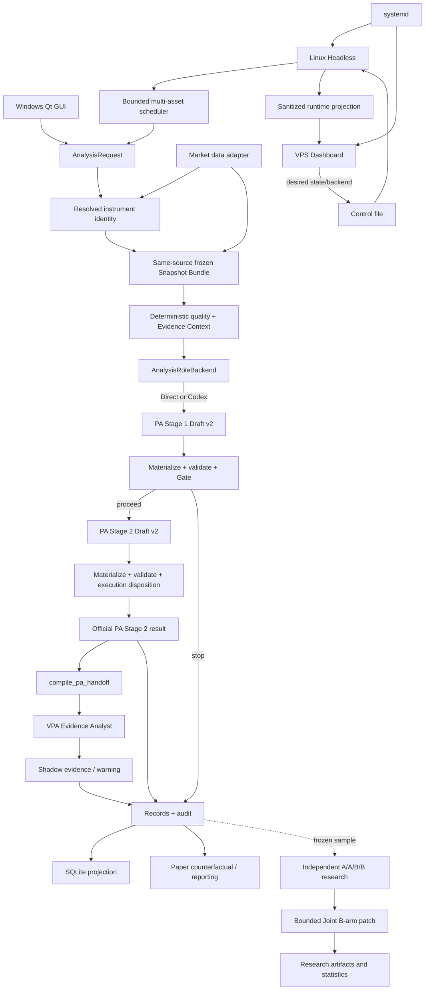

# 架构图谱

本页是组件与决策入口，不定义字段级契约。当前行为以所链接的源码、[CONTEXT.md](../../CONTEXT.md) 和 [ADR](../architecture/) 为准。

## 总览

虚线表示研究消费已落盘的冻结正式分析记录，不是正式 Headless 的同步调用。

## 组件职责

| 组件 | 主要实现 | 拥有的职责 | 不拥有的职责 |
| --- | --- | --- | --- |
| GUI 入口与线程 | [`pa_agent/gui/`](../../pa_agent/gui/)、[`pa_agent/main.py`](../../pa_agent/main.py) | 人工配置、快照冻结期间交互、结果展示、线程生命周期 | 不重写分析结果，不把业务完成信号覆盖 `QThread.finished()` |
| Headless 入口 | [`pa_agent/headless.py`](../../pa_agent/headless.py) | 配置预检、数据 probe、无人值守启动、信号处理 | 不导入 Qt，不管理 Dashboard 页面逻辑 |
| 数据适配与身份 | [`pa_agent/data/`](../../pa_agent/data/) | provider/venue/symbol、合约规格、主周期/HTF、volume provenance | 不判断趋势、Setup 或 Wyckoff 事件 |
| Snapshot | [`snapshot_bundle.py`](../../pa_agent/data/snapshot_bundle.py)、[`snapshot_identity.py`](../../pa_agent/data/snapshot_identity.py) | 同源冻结输入和稳定身份 | 不在排队或分析中静默刷新行情 |
| 确定性 Evidence | [`fact_catalog.py`](../../pa_agent/ai/fact_catalog.py)、[`market_features.py`](../../pa_agent/ai/market_features.py)、[`vpa_measurements.py`](../../pa_agent/ai/vpa_measurements.py) | OHLCV、窗口、比较量、指标和可引用事实 | 不把数值模式命名为 PA/VPA 结构 |
| Prompt 与知识装配 | [`prompt_assembler.py`](../../pa_agent/ai/prompt_assembler.py)、[`pa_theory.py`](../../pa_agent/ai/pa_theory.py)、[`vpa_context_profile.py`](../../pa_agent/ai/vpa_context_profile.py) | 按 PA Context 注入 Brooks/VPA 知识和 Provider Contract | 不建立第二个 Strategy Router |
| Analysis Backend | ADR-0024 规划的 `AnalysisRoleBackend` | 在同一 Draft/Validator 前切换 Direct 与受约束 Codex role execution | 不拥有 Snapshot、Router、materializer、Risk、持久化或交易权限 |
| PA 编排 | [`two_stage.py`](../../pa_agent/orchestrator/two_stage.py) | Stage 1/2 调用、取消、定向修复、失败状态和记录 | 不用 normalizer 猜测专业结论 |
| PA materializer/validator | [`pa_provider_contracts.py`](../../pa_agent/ai/pa_provider_contracts.py)、[`json_validator.py`](../../pa_agent/ai/json_validator.py) | 静态 trace、Gate、方程、明确事实/权限/安全校验 | 不因自由文本专业措辞差异硬拒绝 |
| PA 交接 | [`pa_handoff.py`](../../pa_agent/ai/pa_handoff.py) | 复制已验证 PA 语义并补订单数学、身份、已引用窗口数值位置 | 不补 Setup、位置标签、方向或结论 |
| VPA Analyst | [`role_contracts.py`](../../pa_agent/ai/role_contracts.py)、[`role_validator.py`](../../pa_agent/ai/role_validator.py) | 独立支持/挑战/信息不足的量价报告 | 不改变 PA Gate、方向、价格或胜率 |
| Joint 研究 | [`pa_agent/experiments/`](../../pa_agent/experiments/) | 冻结 A1/A2/B1/B2、cohort、租约、配对统计和有界 patch | 不进入正式 Headless 或 `pa-official` 结果 |
| 执行与 Paper | [`execution_policy.py`](../../pa_agent/ai/execution_policy.py)、[`pa_agent/execution/`](../../pa_agent/execution/) | candidate 外的执行资格、Paper ledger、报告 | 不修改模型原始 candidate；反事实不冒充真实成交 |
| Records/audit | [`pa_agent/records/`](../../pa_agent/records/)、[`monitoring/audit.py`](../../pa_agent/monitoring/audit.py) | 完整分析、审计、投影、回放和质量统计 | 不把运行投影当成权威原始记录 |
| 多资产运行时 | [`pa_agent/monitoring/`](../../pa_agent/monitoring/) | 同资产 FIFO、全局有界并发、独立 client/orchestrator、恢复 | 不共享可变模型会话或跨资产复用身份 |
| Operation projection | [`pa_agent/operations/`](../../pa_agent/operations/) | 脱敏 runtime status 和 desired control state | 不承载交易分析 authority |
| Dashboard | [`dashboard.py`](../../pa_agent/dashboard.py)、[`dashboard_page.py`](../../pa_agent/dashboard_page.py) | loopback Web UI、Basic token、状态读取和暂停/恢复请求 | 不读内部 DB、配置、Provider key，不启动/停止 systemd service |

## 数据面与控制面

**数据面**从行情身份开始，经 Snapshot、PA/VPA、records、Paper 和研究 artifact。它包含敏感配置、完整分析证据和交易候选，归 Headless 用户与 `PA_AGENT_HOME` 所有。

**控制面**只包含 Headless 发布到 operation directory 的脱敏状态，以及 Dashboard 写入的
`running/paused` desired state 与 ADR-0024 限定的 `deepseek_only/auto/codex_only` desired backend：

- `generation` 表示最新控制请求；`applied_control_generation` 表示 Headless 已应用的版本。
- “已写入暂停”不等于“已经生效”，Dashboard 必须比较 desired/applied generation 与 runtime state。
- 暂停只阻止新任务；进行中的冻结分析安全完成，不被 Dashboard 中断或重判。
- systemd 管理进程启动、停止和重启。Dashboard 不是进程管理器。
- Dashboard 绑定 `127.0.0.1`/`localhost`，推荐经 SSH tunnel 访问。

详见 [ADR-0023](../architecture/ADR-0023-vps-observability-and-control-plane.md)。
Codex Backend 的隔离、完整链 fallback 和 backend A/A/B/B 见
[ADR-0024](../architecture/ADR-0024-codex-analysis-backend.md)。

## 失败边界

| 边界 | 处理原则 |
| --- | --- |
| 数据身份、时序、关键 OHLC 无效 | `unavailable_input`，不调用模型或产生订单 |
| PA Provider 不可用 | `unavailable_provider`，保留诊断和有界重试语义 |
| PA Draft 一次定向修复后仍无效 | `invalid_model_output`，不产生可执行订单 |
| VPA Shadow 失败 | 保留有效 PA，固定记录 `completed_with_warnings` 与失败角色 |
| Joint B 臂失败 | `degraded_pa_only`，研究臂保留 PA baseline，不污染正式结果 |
| 持久化失败 | 不记“幽灵成功”，成功去重历史只接收完整落盘分析 |
| Dashboard/控制文件无效 | Headless fail-closed 暂停新任务，保留明确 `control_error` |
| 未分类内部错误 | `internal_error`，保留可诊断上下文，不伪装为 Provider 错误 |

## ADR 导航

| 主题 | ADR |
| --- | --- |
| 分析 authority、Provider 校验、PA/VPA/Joint 角色 | [0001](../architecture/ADR-0001-analysis-authority.md)、[0002](../architecture/ADR-0002-provider-validation-boundary.md)、[0003](../architecture/ADR-0003-pa-vpa-joint-roles.md) |
| Context Prompt、A/A/B/B、运行时 | [0004](../architecture/ADR-0004-context-sliced-prompts.md)、[0005](../architecture/ADR-0005-offline-pa-vpa-aabb.md)、[0006](../architecture/ADR-0006-bounded-multi-asset-runtime.md)、[0007](../architecture/ADR-0007-linux-headless-runtime.md) |
| Record、Shadow/Joint、instrument/data/Paper | [0008](../architecture/ADR-0008-canonical-record-and-validation-boundaries.md) 至 [0015](../architecture/ADR-0015-runtime-recovery-and-frozen-execution-facts.md) |
| Reasoning、事实/执行、Evidence、风险/VPA | [0016](../architecture/ADR-0016-role-based-reasoning-profiles.md) 至 [0020](../architecture/ADR-0020-contextual-risk-probability-and-vpa-seasonality.md) |
| 持续研究、发布资源、VPS 控制面、Codex Backend | [0021](../architecture/ADR-0021-continuous-paired-joint-research.md)、[0022](../architecture/ADR-0022-runtime-resource-and-release-reproducibility.md)、[0023](../architecture/ADR-0023-vps-observability-and-control-plane.md)、[0024](../architecture/ADR-0024-codex-analysis-backend.md) |

继续阅读：[分析链路](analysis-pipeline.md) · [原则与边界](principles-and-boundaries.md) · [当前状态](current-status.md)
